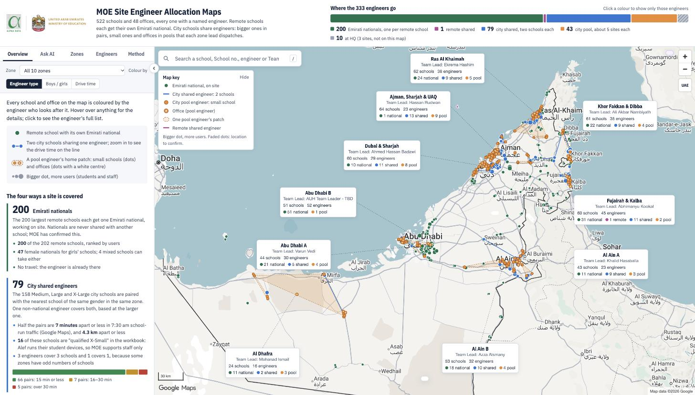
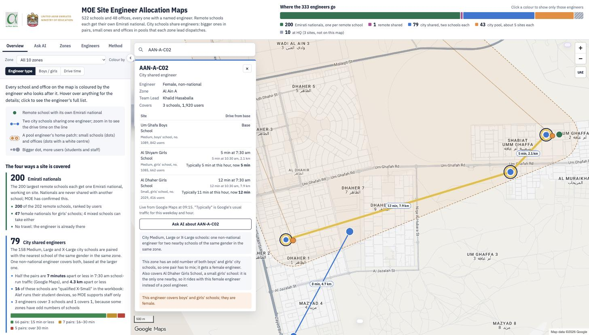
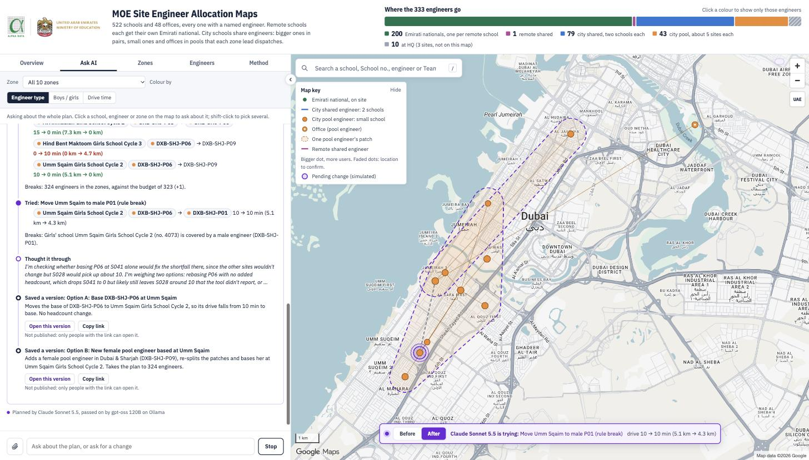
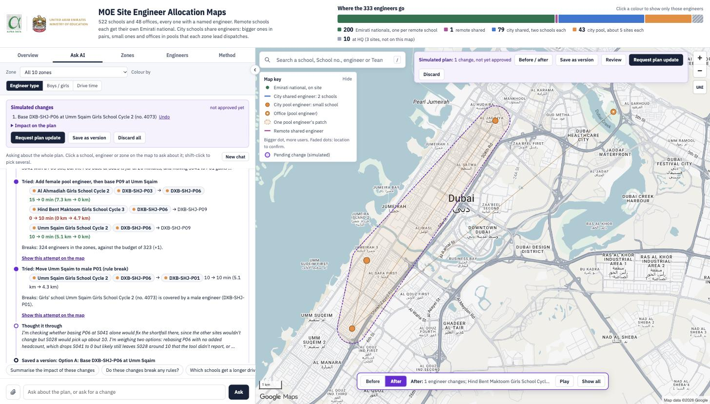
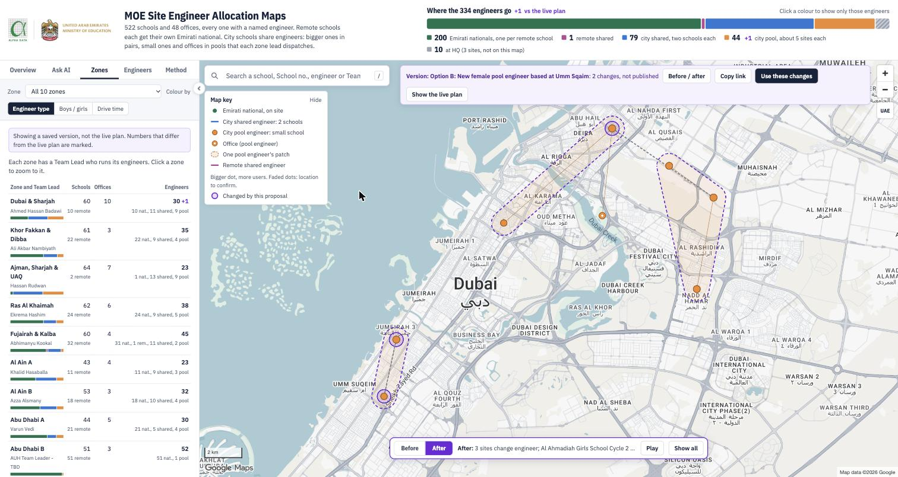
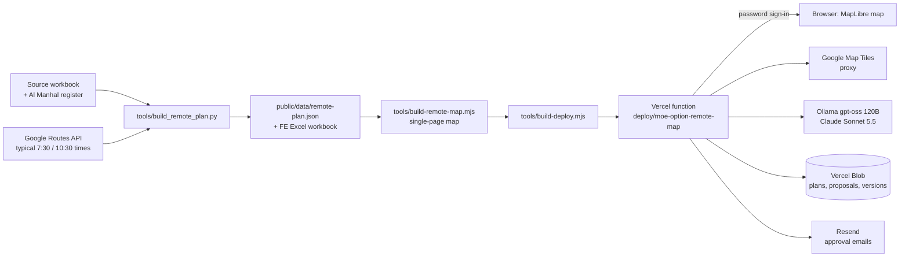

# MOE Site Engineer Allocation Maps

An interactive map and AI planner that shows which field engineer looks after every UAE Ministry of Education (MOE) school and office. It also lets the planning team change that allocation safely: changes are simulated, compared before and after, and applied only after a named approver confirms them by email.

Built by Skyform / Alpha Data for the MOE end-user computing (EUC) support programme. The live site is password-protected.



---

## The problem

MOE's EUC support model puts field engineers in 10 zones to cover **522 schools and 48 offices**. Deciding who covers what has to satisfy several rules at once:

- **Emirati nationals are dedicated.** The largest remote schools each get one Emirati national on site, and nationals are never shared.
- **Gender.** Every girls' school must be covered by a female engineer.
- **Drive time.** Engineers should reach their sites quickly in real school-run traffic, with a 30-minute service target.
- **Budget and structure.** A fixed engineer budget, split across zones that each have a Team Lead who dispatches work.

The allocation lived in spreadsheets. They can't show geography, real drive times, or the knock-on effect of moving one school. Every "what if we move this school?" meant hours of manual checking, and decisions were hard to explain to the MOE director. There was also no controlled way to propose a change, have it approved, and know which version of the plan was current.

## The solution

One map, built from the project lead's workbook and real Google Maps drive times, that anyone on the team can open and understand:

1. **A reproducible plan.** A builder script reads the source workbook, applies the rules in order, and looks up typical 7:30 am and 10:30 am drive times from Google Maps. It writes the plan as data (`public/data/remote-plan.json`) and an engineer-by-engineer Excel workbook.
2. **A map that explains itself.** Every site is coloured by the engineer who covers it: national, city shared pair, city pool patch, or remote shared. Hover cards, engineer panels and the side tabs explain why each site sits where it does.
3. **An AI assistant that knows the plan.** Questions are answered from the plan's own data. Requests to change the plan are worked out step by step by a planning agent. It tests each option on the same plan engine the map uses and shows every attempt on the map as it happens.
4. **Controlled change.** Changes are only simulated until an approver confirms them by email. Approved changes become a new numbered version of the live plan. Alternative plans can be saved as private versions with unlisted links.

## Features and functionality

### The map
- **Coverage at a glance:** 10 zones with Team Lead cards, a headcount bar ("Where the N engineers go") and colour modes by engineer type, boys/girls, or drive-time band.
- **Google Maps basemap:** Map Tiles API, served through the site so the key stays private.
- **Drive time and distance everywhere:** each link shows typical minutes and road km, for example "12 min, 7.9 km". Clicking an engineer adds live traffic: "typically 5 min at this hour, now 5 min".
- **Search:** find any school (English or Arabic name, school number), office, engineer id, zone or Team Lead.
- **Pick to ask:** click a site, engineer or zone, or shift-click several, then ask the assistant about them. "Show these N on the map" hides everything else until **Show all**.
- **Layout controls:** the side panel can be resized and collapsed. The page opens at 80% zoom on a Mac and 67% on Windows.



### The side panel
- **Overview:** the four ways a site is covered, with counts, medians and the open questions.
- **Ask AI:** the assistant (below).
- **Zones:** schools, offices and engineers per zone and Team Lead.
- **Engineers:** a searchable list with each engineer's longest trip.
- **Method:** the rules, sources and plan version.

Every number in these tabs is computed from the plan being shown. When it isn't the live plan (a simulated change, a version or a proposal), each tab says so and marks the differences, such as "30 +1".

### The AI assistant
- **Two models, each used for what it does best.** Every request goes to **Ollama (gpt-oss 120B)** first, which answers questions directly in about 2 seconds. When a request involves changing the plan, Ollama hands it to **Claude Sonnet 5.5**, which plans it. If Claude is unavailable, Ollama plans instead. Every answer says which model wrote it.
- **Long-running planning agent.** For change requests Claude works through up to 16 rounds. It uses medium effort for simple changes and high for options, several changes or zone-wide work. It has its own tools:
  - `find_engineers`: who could take a site, nearest first, with Google drive times and any rule that stops them;
  - `try_changes`: tests changes on the plan engine (drive before and after, rules broken, impact);
  - `stage_changes`: puts the chosen changes on the user's simulated plan;
  - `save_version`: saves an alternative plan as its own private version.
- **Live view of the planning.** Each step streams into the chat: Claude's reasoning summary, the engineers it compared, every attempt and the versions it saved. Each attempt appears on the map straight away, showing only the sites it touches. A pulsing ring marks the moving school and a grey line shows its old engineer. A **Before/After** switch works while it plans.
- **Grounded answers.** The knowledge base is the decisions guide (`tools/kb/decisions.md`) plus the plan's own data tables, the selected items and any pending changes. Answers link every school, engineer and zone back to the map.
- **Attachments.** Attach or paste images, PDFs, Excel, CSV or text. Ollama reads text; images and PDFs go to Claude.



### Simulate, compare, approve
- **Simulated changes** stay in the user's browser and are drawn in violet. The engine supports these changes: move, swap, base, add, remove, gender and re-split. A change that would break an MOE rule needs an explicit "Break the rule" click before it is simulated.
- **Before / after:** whenever a change is presented, the map shows only what it touches. That's the moving sites plus every site of the engineers who gain or lose work. A switch flips between the live plan and the changed plan, Play alternates them, and the B and A keys switch too.
- **Request plan update:** emails the approvers a summary of the change, its impact and any rules broken. Each approver gets a signed confirm link. The first decision wins, and an approved change becomes the next version of the live plan.
- **Map versions:** alternative plans can be saved, by Claude or with **Save as version**, under an unguessable link (`?version=…`). Versions are not published and not listed anywhere. Anyone with the link and the site password can open one in before/after, copy the link, or load its changes into their own simulated plan.





## How it works



- **`tools/plan-engine.mjs`** holds the rules, simulation, impact and checks. The same file runs in the browser (inlined into the map page) and on the server, so a simulated change looks the same everywhere.
- **`tools/app-api.mjs`** is the server routes, shared by the local `server.js` and the Vercel function:
  - `/api/plan`, `/api/drive`, `/api/live`, `/api/ask` (the assistant, streamed);
  - `/api/proposals`, `/api/scenarios` (versions), `/approve`;
  - `/tiles/*`.
- **`tools/assistant.mjs`:** Ollama-first routing, the Claude planning agent and its tools, and the cached knowledge-base prompt.
- **`tools/store.mjs`:** the private Vercel Blob store for plan versions, proposals, decisions and saved versions. Decisions are write-once.
- **`tools/mailer.mjs`:** approval and decision emails through Resend.
- **`deploy/moe-option-remote-map/api/index.js`:** one Vercel function serving the whole site behind a shared password (30-day signed cookie). Only the signed approval links work without it.

## Repository layout

```
server.js                     local server (map at /remote, uses a dev/ store and a test inbox)
public/
  remote-map.src.html         the map page (source; built into dist/)
  data/remote-plan.json       the plan (version 0) produced by the builder
  brand/                      Alpha Data and MOE logos
  index.html, js/, css/       earlier prototype: school-day dispatch simulation and guided demo
  coverage-map.src.html       earlier prototype: coverage-cluster map
tools/
  build_remote_plan.py        builds the Option Remote plan from the workbook (+ --google to refresh drive times)
  google_times.py             Google Routes lookups, cached in google-cache.json
  plan-engine.mjs             rules, simulation, impact, checks, knowledge-base tables
  assistant.mjs               AI assistant (Ollama + Claude planner)
  app-api.mjs, store.mjs, mailer.mjs, google-tiles.mjs   server modules
  build-remote-map.mjs        builds dist/MOE-Option-Remote-Coverage-Map.html
  build-deploy.mjs            copies the build and modules into the Vercel project
  deploy-remote-map.sh        rebuild + deploy in one step
  kb/decisions.md             the decisions guide the assistant reads
  vendor/                     MapLibre GL 4.7.1
deploy/moe-option-remote-map/ the Vercel project (api/index.js, vercel.json)
docs/                         design notes and screenshots
```

## Running it locally

Requirements: Node.js 22+, Python 3.11+ (with `openpyxl` and `networkx`) if you rebuild the plan, and the keys listed in `.env.example`.

```bash
npm install
cp .env.example .env          # fill in the keys
node tools/build-remote-map.mjs
PORT=5199 node server.js      # open http://localhost:5199/remote
```

The local server never touches live data. It stores proposals and versions under a `dev/` prefix and sends every email to Resend's test inbox (`delivered@resend.dev`).

Rebuilding the plan needs the source workbooks, which are not in git (see **Data**). Put them in the repository root, then:

```bash
python3 tools/build_remote_plan.py            # uses the cached Google drive times
python3 tools/build_remote_plan.py --google   # also looks up any missing drive times
```

## Deploying

The site runs on Vercel (project `moe-option-remote-map`).

1. Link the Vercel project once: `cd deploy/moe-option-remote-map && npx vercel link`.
2. Add the settings from `.env.example` as Vercel environment variables, marked sensitive.
3. Deploy:

```bash
tools/deploy-remote-map.sh     # rebuild plan + map + bundle, then vercel deploy --prod
```

Once a version 1 or later has been approved, the live plan lives in the Blob store, so redeploying never overwrites approved changes.

## Settings

All settings are environment variables; see `.env.example`. None are committed.

| Name | What it's for |
|---|---|
| `MAP_PASSWORD` | the shared site password |
| `GOOGLE_MAPS_API_KEY` | Routes API (drive times, live traffic) and Map Tiles API (basemap) |
| `OLLAMA_HOST`, `OLLAMA_KEY`, `OLLAMA_MODEL` | the assistant for questions (default `gpt-oss:120b`) |
| `CLAUDE_KEY` (`CLAUDE_MODEL`, `CLAUDE_EFFORT`) | the planning agent (default `claude-sonnet-5-5`) |
| `RESEND_KEY` | approval emails |
| `APPROVAL_SECRET` | signs approve/reject links |
| `BLOB_READ_WRITE_TOKEN` | private Vercel Blob store |
| `SITE_URL` | public address used in email links |
| `APPROVERS` | optional override of the approver list |

## Data

- **In git:**
  - the built plan (`public/data/remote-plan.json`);
  - the cached Google drive times (`tools/google-cache.json`);
  - the decisions guide (`tools/kb/decisions.md`).
- **Not in git:**
  - the raw source files: MOE workbooks (`.xlsx`), the deck (`.pptx`) and meeting transcripts;
  - generated builds (`dist/`, `deploy/…/lib/`).

  Keep the source files in the shared project folder.
- **Sources:**
  - *MOE EUC Zone Engineer Allocation, Option Remote*: schools list, non-school sites, zones and Team Leads, nationals breakdown;
  - the *Al Manhal* school register: rural flags and Arabic names;
  - Google Maps Platform: Routes API and Map Tiles API.

## Security notes

- The whole site sits behind one shared password. Approval links are signed per approver (HMAC) and expire after 7 days.
- Keys stay on the server. Map tiles and AI calls go through the site's own server, so no key ever reaches the browser.
- Saved versions use 128-bit random ids, are never listed, and still need the site password.
- The planning agent cannot send approval emails. Only a person can press **Request plan update**.
